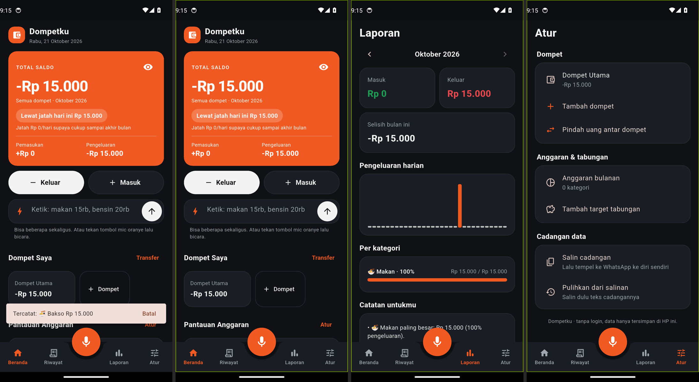

# Dompetku

Catatan dompet harian tanpa login. Data tersimpan di HP, tanpa akun, tanpa internet.

## ⬇️ [Unduh Dompetku.apk](https://github.com/asammanis89/dompetku-release/raw/main/Dompetku.apk)

Versi terbaru: **v0.2.0**. Ukuran sekitar 50 MB.

## Yang baru di v0.2.0

- Memperbaiki layar hitam saat dibuka di v0.1.0.
- Catat pakai **suara** (tombol mic oranye) atau ketik beberapa sekaligus: `makan 9k, bensin 20rb`.
- **Banyak dompet** (Tunai, DANA, Bank) dan pindah uang antar dompet.
- **Anggaran** per kategori dan **target tabungan**.
- **Riwayat** dengan pencarian, **Laporan** bulanan dengan catatan otomatis, salin laporan ke WhatsApp.
- Sembunyikan saldo dengan ikon mata.

## Cara pasang

1. Buka link **Unduh Dompetku.apk** di atas dari HP Android.
2. Buka file yang terunduh.
3. Kalau diminta, izinkan **Instal aplikasi tidak dikenal** untuk browser atau File Manager.
4. Kalau Play Protect bilang "aplikasi tidak dikenal", pilih **Tetap instal**.

## Update

Unduh lagi dari link yang sama, lalu pasang di atas versi lama. Catatanmu tetap aman, jangan uninstall dulu.
