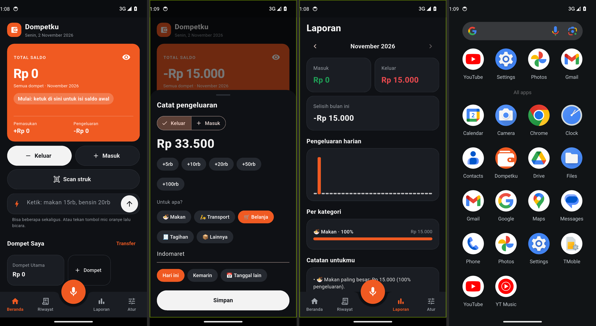

# Dompetku

Catatan dompet harian tanpa login. Data tersimpan di HP, tanpa akun. Dibuat oleh **Ardha**.

## ⬇️ [Unduh Dompetku.apk](https://github.com/asammanis89/dompetku-release/raw/main/Dompetku.apk)

Versi terbaru: **v0.4.0**. Ukuran sekitar 80 MB.

## Yang baru di v0.4.0

- **Tampilan baru**: gelap mengkilap dengan aksen oranye.
- **Update dari dalam aplikasi**: kalau ada versi baru, Dompetku memberi tahu. Pilih **Perbarui**, **Nanti**, atau **Lewati versi ini**.
  Bisa dimatikan di **Atur → Pembaruan**.
- **Tombol Dukung** (kanan atas): saweran untuk pengembang lewat DANA.
- Ketik cepat tidak lagi diubah oleh autokoreksi keyboard (misalnya "bakso" jadi "Baks").

> Pengguna v0.3.0: pasang v0.4.0 ini **sekali secara manual** dari link di atas. Mulai v0.4.0, update berikutnya muncul sendiri di aplikasi.

## v0.3.0

- **Scan struk**: foto struk (atau pilih dari galeri), total dan nama toko terisi otomatis, tinggal periksa lalu simpan.
  Scan pertama butuh internet sebentar untuk menyiapkan pembaca struk; setelah itu bisa tanpa internet.
- **Logo Dompetku** sendiri.
- **Isi saldo awal / sesuaikan saldo**: ketuk kartu dompet lalu isi uang yang sebenarnya.
- Tombol kembali (back) sekarang ke Beranda dulu, tidak langsung keluar.

## v0.2.0

- Memperbaiki layar hitam saat dibuka di v0.1.0.
- Catat pakai **suara** (tombol mic oranye) atau ketik beberapa sekaligus: `makan 9k, bensin 20rb`.
- **Banyak dompet** (Tunai, DANA, Bank) dan pindah uang antar dompet.
- **Anggaran** per kategori dan **target tabungan**.
- **Riwayat** dengan pencarian, **Laporan** bulanan dengan catatan otomatis, salin laporan ke WhatsApp.
- Sembunyikan saldo dengan ikon mata.

## Cara pasang

1. Buka link **Unduh Dompetku.apk** di atas dari HP Android.
2. Buka file yang terunduh.
3. Kalau diminta, izinkan **Instal aplikasi tidak dikenal** untuk browser atau File Manager.
4. Kalau Play Protect bilang "aplikasi tidak dikenal", pilih **Tetap instal**.

## Update

Saat ada versi baru, Dompetku menawarkan update. Pilih **Perbarui**, tunggu unduhan selesai, lalu **Instal**.
Pertama kali, Android akan bilang *"HP tidak diizinkan menginstal aplikasi tidak dikenal dari sumber ini"*:
ketuk **Setelan**, nyalakan **Izinkan dari sumber ini** untuk Dompetku, lalu kembali dan pilih **Instal**.

Bisa juga unduh lagi dari link di atas, lalu pasang di atas versi lama. Catatanmu tetap aman, **jangan uninstall dulu**.
